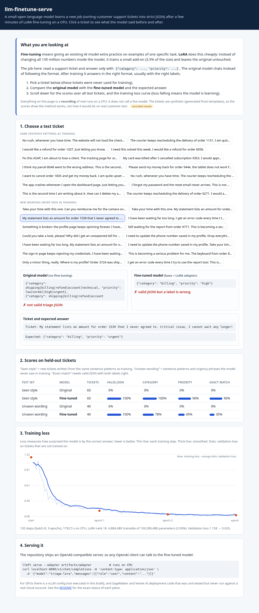
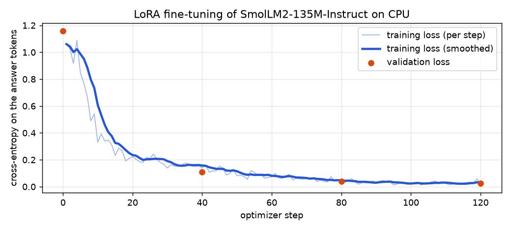
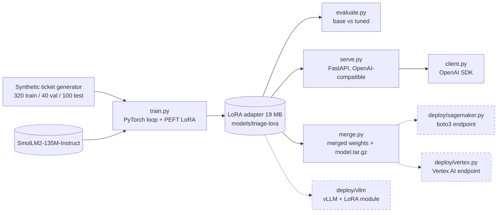

**▶ Live demo (no login, click a ticket): https://tanvir-ux.github.io/llm-finetune-serve/**



# llm-finetune-serve

Teach a small open model a new job with **LoRA fine-tuning in plain PyTorch**, check the result against the untouched model, and **serve it behind an OpenAI-compatible API**, with a vLLM configuration and SageMaker and Vertex AI deployment code alongside.

The task is deliberately small and fully reproducible on a laptop CPU: read a customer support ticket and reply with strict JSON, `{"category": ..., "priority": ...}`.

> **Read this first: what is real and what is not.** The training, evaluation, server, client and merge steps below were all **run for real on a CPU** and their output is in [`docs/demo/`](docs/demo). QLoRA, vLLM, SageMaker and Vertex AI were **written but never run**: they need a GPU or cloud accounts that were not available. The dataset is **synthetic** and written by me, so the scores show that the pipeline works, not how a model would do on real customer text. The web demo is a **recording** of these runs, not a live model.

## Results (measured, CPU, 30 minutes of training)

Base model: `HuggingFaceTB/SmolLM2-135M-Instruct`. LoRA rank 16 on all attention and MLP projections: **4,884,480 trainable parameters of 139.4 million in total (3.5%)**. 120 optimizer steps (3 epochs, batch 8, 320 training tickets), 1,792 s on 8 CPU cores. Validation loss went from 1.158 to 0.023.



Evaluation uses 100 tickets that share no text with the training set. **Seen style** = new tickets built from the same sentence patterns as training. **Unseen wording** = sentence patterns and urgency phrases held out of training. Scoring is strict: the reply must be a JSON object with exactly the keys `category` and `priority`.

| model | test set | n | valid JSON | category | priority | exact match |
|---|---|---|---|---|---|---|
| base | seen style | 60 | 0% | 0% | 0% | 0% |
| base | unseen wording | 40 | 0% | 0% | 0% | 0% |
| **LoRA-tuned** | seen style | 60 | **100%** | **100%** | 90% | **90%** |
| **LoRA-tuned** | unseen wording | 40 | **100%** | 78% | 45% | 35% |

How to read this honestly:

- The base model scores 0% because it echoes the instruction (`{"category": shipping|billing|...}`) instead of choosing a value, so no reply parses. That is a format failure, not proof that the base model cannot understand tickets. A few-shot prompt would likely help it, and comparing against few-shot prompting is a sensible next experiment.
- The tuned model always produces valid JSON. On wording it has never seen it still gets the category right 78% of the time, but **priority drops to 45%**: it learned the urgency phrases it was shown and generalises poorly to new ones. I report this rather than hide it. More varied data would be the fix.
- One training run, one seed. No confidence intervals.

Raw logs: [`docs/demo/train.txt`](docs/demo/train.txt), [`docs/demo/eval.txt`](docs/demo/eval.txt). Every reply of both models is in [`docs/results.json`](docs/results.json) and browsable on the demo page.

## Architecture



Solid lines were executed. Dashed lines are written, unit-tested where possible, and **not executed against real infrastructure**.

## What ran live and what did not

| Piece | Status | Evidence |
|---|---|---|
| LoRA fine-tuning (PyTorch loop, PEFT, CPU) | **Executed** | `docs/demo/train.txt`, `models/triage-lora/train_log.json` |
| Evaluation, base vs tuned | **Executed** | `docs/demo/eval.txt`, `docs/results.json` |
| OpenAI-compatible server (transformers backend, CPU) | **Executed**, queried with the OpenAI Python SDK and curl | `docs/demo/serve-*.txt`; CI also builds the Docker image and sends a chat request |
| Merge adapter into base, build `model.tar.gz` | **Executed**, merged model gives the same answer | `docs/demo/merge.txt` |
| 23 unit tests, ruff, GitHub Actions | **Executed** (tests use a tiny random model, so they run offline in seconds) | CI badge below |
| QLoRA (`--qlora`, 4-bit NF4 via bitsandbytes) | **Not executed.** Needs a CUDA GPU. The code path exists but is unverified | n/a |
| vLLM with the LoRA adapter (`deploy/vllm`) | **Not executed.** Needs a GPU. Option names were checked against the vLLM documentation | n/a |
| SageMaker endpoint (`deploy/sagemaker.py`) | **Not executed against AWS.** The three API requests are validated against botocore's API model with a `Stubber`. You must supply a serving container image; the environment variables in the file are examples to check against that container's docs | `tests/test_deploy.py` |
| Vertex AI endpoint (`deploy/vertex.py`) | **Not executed against Google Cloud.** Only the argument builders and `gcloud` command text are unit-tested | `tests/test_deploy.py` |
| Hosted live inference | **Not provided.** The demo page is a static recording. A Hugging Face Space recipe is in `deploy/huggingface/` but was not published (no token) | n/a |

## Quick start

```bash
python -m venv .venv && source .venv/bin/activate
pip install -r requirements.txt -r requirements-dev.txt && pip install --no-deps -e .

llmft data                      # dataset statistics and samples
llmft train --epochs 3          # about 30 minutes on 8 CPU cores, writes artifacts/adapter
llmft eval                      # base vs tuned, writes artifacts/eval.json
python scripts/build_demo.py    # refreshes docs/results.json, the plot and models/triage-lora

# The repository already contains a trained adapter, so you can skip training:
llmft serve --adapter models/triage-lora          # http://127.0.0.1:8000/v1
llmft chat "I was charged twice and the refund has not arrived."   # uses the OpenAI SDK
```

Because the endpoint is OpenAI-compatible, any client works:

```python
from openai import OpenAI
from llm_finetune_serve.modeling import ticket_messages

client = OpenAI(base_url="http://127.0.0.1:8000/v1", api_key="unused")
reply = client.chat.completions.create(
    model="triage-lora",  # or "base" for the untouched model
    messages=ticket_messages("My parcel never arrived and I need it urgently."),
)
print(reply.choices[0].message.content)  # {"category": "shipping", "priority": "urgent"}
```

The CPU server loads the model lazily on the first chat request, does not stream (`stream: true` returns HTTP 400), and is meant for demonstration, not throughput. Use vLLM for that.

## Deploying (not executed)

All of this is untested against live infrastructure. Treat it as a starting point and read the notes in each file.

```bash
# vLLM on a GPU machine (config checked against the vLLM docs, never run)
vllm serve --config deploy/vllm/config.yaml        # or: docker compose -f deploy/vllm/docker-compose.yml up

# SageMaker: merge, upload, create endpoint (needs AWS credentials, a role and a container image)
llmft merge --out artifacts/merged --tar artifacts/model.tar.gz
aws s3 cp artifacts/model.tar.gz s3://YOUR-BUCKET/triage/model.tar.gz
python -m llm_finetune_serve.deploy.sagemaker --name triage --image-uri <serving-image> \
    --model-data s3://YOUR-BUCKET/triage/model.tar.gz --role-arn <execution-role-arn>

# Vertex AI: see deploy/vertex.py, `gcloud_commands()` prints the equivalent CLI calls
```

Hugging Face Space (Docker, CPU): `HF_TOKEN=... deploy/huggingface/push_space.sh`. Not run.

## Repository layout

```
src/llm_finetune_serve/
  data.py        synthetic ticket generator and train/val/test splits
  modeling.py    model and tokenizer loading, chat rendering, batched generation, strict JSON parser
  train.py       plain PyTorch LoRA/QLoRA loop (masked prompt loss, warmup + cosine LR, grad clipping)
  evaluate.py    base (adapter disabled) versus tuned scoring
  serve.py       OpenAI-compatible FastAPI server    client.py   OpenAI SDK client
  deploy/        merge.py, sagemaker.py, vertex.py, vllm/ (config and compose)
models/triage-lora/   the trained adapter (19 MB) and its training log
docs/                 GitHub Pages demo and recorded outputs
scripts/build_demo.py turns train/eval artifacts into the demo data and plot
tests/                23 offline tests
```

## Design notes

- **Loss only on the answer.** Prompt tokens are masked with `-100`, so the model is trained to produce the JSON, not to memorise ticket text.
- **No leakage.** The generator removes every training ticket from the other splits, and the unseen test set uses held-out sentence templates and urgency cues.
- **Pinned dependencies.** `requirements.txt` pins the CPU PyTorch build used here. `pyproject.toml` keeps looser ranges.

## Development

```bash
ruff check . && ruff format --check . && pytest -q
```

CI ([`.github/workflows/ci.yml`](.github/workflows/ci.yml)) runs lint and tests, then builds the Docker image, starts the server and sends a real chat request through the fine-tuned model.

## Licence

MIT, see [LICENSE](LICENSE).
